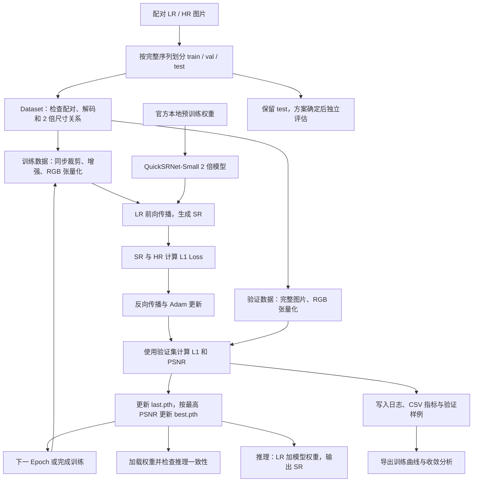

# QuickSRNet-Gaming 微调管线指南：从输入图片到模型权重与超分辨率结果

本文解释当前项目实际运行的管线，覆盖数据组织、张量输入输出、预训练模型加载、训练、验证、断点续训、结果读取和单张图片推理。说明依据仓库代码及已经完成的 100 Epoch 实验，记录日期为 **2026 年 10 月 19 日**。

项目根目录为 `F:\CADCG\SRTP\QuickSRNet-Gaming`。下文目录树与命令中的相对路径均以该目录为起点。实验运行名为 `asian-village-20261018-200240`。

## 1. 这条管线要解决什么问题

本项目是一项**监督式图像超分辨率回归任务**：让 QuickSRNet-Small 学习将游戏场景的低分辨率图片 LR，重建为宽、高各扩大 2 倍的图片 SR。

训练数据提供同一帧的 LR 与 HR。模型读取 LR 生成 SR，再通过 SR 与 HR 的差异调整参数。HR 是监督目标，不会与 LR 拼接后输入网络。训练完成后，推理只需要 LR 和模型权重。

| 名称 | 含义 | 在管线中的作用 |
|---|---|---|
| LR，Low Resolution | 采集得到的低分辨率图片 | 网络输入 |
| HR，High Resolution | 同一帧的高分辨率参考图片 | 训练的监督目标、验证的比较基准 |
| SR，Super Resolution | 模型根据 LR 预测的超分辨率图片 | 网络输出 |
| 预训练权重 | 官方已经训练好的网络参数 | 本次微调的起点 |
| 微调权重 | 使用当前游戏数据继续优化后的参数 | 后续推理或评估使用的模型 |
| Checkpoint | 权重及训练状态的保存文件 | 保存成果、恢复训练 |

当前模型为**单帧模型**。虽然数据来源于六条视频序列，每次网络前向传播只处理一张图片，或一批彼此独立的图片；没有输入前后帧、光流、深度或运动向量，也没有时域一致性损失。

## 2. 管线总览及输入输出



图中的“下一 Epoch”分支重复执行训练与验证，达到设定的总轮数后结束。Test 是保留分支，当前正式训练入口不会加载它。

| 阶段 | 输入 | 主要处理 | 输出 |
|---|---|---|---|
| 数据整理 | 原始六条序列 | 保留序列边界，按用途分组 | train、val、test 目录 |
| Dataset 初始化 | LR、HR 根目录 | 递归配对，完整解码并检查尺寸 | 有效图片对索引 |
| 训练数据读取 | 一对完整 LR、HR | 同步随机裁剪与增强，转 RGB 张量 | `lr`、`hr`、样本 `name` |
| DataLoader | Dataset 样本 | 打乱训练顺序、并行读取、组成 batch | 一批 LR 和 HR 张量 |
| 模型加载 | 网络结构、官方权重，可选恢复 checkpoint | 严格加载参数，恢复已有训练状态 | 可训练模型与优化器 |
| 一次训练更新 | LR batch、HR batch、当前参数 | 前向传播、L1、反向传播、Adam | 更新后的参数、训练损失 |
| 一轮验证 | 验证 LR、HR、当前参数 | 整图推理，计算 L1 与逐帧 PSNR | 本轮验证指标 |
| 保存与可视化 | 参数、状态、历史指标、验证样本 | 写文件，维护历史最高 PSNR | checkpoint、CSV、日志、图片 |
| 断点续训 | 已保存 checkpoint、新的总 Epoch 数 | 恢复权重和训练状态 | 从下一 Epoch 开始的训练 |
| 训练后推理 | LR、选定模型权重 | 预处理、前向传播、转回图片 | SR 图片 |

## 3. 原始数据与划分方式

### 3.1 实际数据数量

原始数据位于 `F:\CADCG\SRTP\Asian_Village_Demo`。每条序列包含 240 张 LR 和 240 张 HR，共 480 个图片文件，也就是 **240 对配对样本**。六条序列合计 1,440 对、2,880 张图片。

| 集合 | 序列 | 配对样本数 | 图片文件数 | 用途 |
|---|---|---:|---:|---|
| Train | Scene_1_01、Scene_1_03、Scene_1_04、Scene_1_06 | 960 | 1,920 | 计算梯度，更新参数 |
| Validation | Scene_1_02 | 240 | 480 | 每轮评估，选择最佳权重 |
| Test | Scene_1_05 | 240 | 480 | 固定方案后的独立评估 |

本次已检查数据的分辨率为：LR **960×540**，HR **1920×1080**。这里图片尺寸按“宽×高”描述。宽、高各放大 2 倍后，像素总数变为原来的 4 倍。

### 3.2 训练目录结构

```text
data/gaming/
├── train/
│   ├── LR/
│   │   ├── Scene_1_01/frame_0000.png ... frame_0239.png
│   │   ├── Scene_1_03/frame_0000.png ... frame_0239.png
│   │   ├── Scene_1_04/frame_0000.png ... frame_0239.png
│   │   └── Scene_1_06/frame_0000.png ... frame_0239.png
│   └── HR/
│       ├── Scene_1_01/frame_0000.png ... frame_0239.png
│       ├── Scene_1_03/frame_0000.png ... frame_0239.png
│       ├── Scene_1_04/frame_0000.png ... frame_0239.png
│       └── Scene_1_06/frame_0000.png ... frame_0239.png
├── val/
│   ├── LR/Scene_1_02/frame_0000.png ... frame_0239.png
│   └── HR/Scene_1_02/frame_0000.png ... frame_0239.png
└── test/
    ├── LR/Scene_1_05/frame_0000.png ... frame_0239.png
    └── HR/Scene_1_05/frame_0000.png ... frame_0239.png
```

配对依据是 **LR/HR 各自根目录下的相对路径与不含扩展名的文件名**。例如下面两张图片组成一对：

```text
train/LR/Scene_1_03/frame_0120.png
train/HR/Scene_1_03/frame_0120.png
```

同名的 `Scene_1_04/frame_0120.png` 属于另一对，不会冲突。当前代码支持 PNG、JPG、JPEG，扩展名可以不同；匹配键不区分大小写，也兼容 `name_lr.png` 与 `name_hr.png`。不同扩展名在同一侧产生重复匹配键时，会报告歧义。

按整条序列划分可以避免同一序列的相邻帧被随机拆到训练集与验证集。不同序列仍可能包含相似地点；这六条序列来自同一游戏场景，因此结果的适用范围目前主要是该场景下的新序列。

## 4. Dataset：从图片文件到训练样本

实现位置：[src/dataset.py](F:/CADCG/SRTP/QuickSRNet-Gaming/src/dataset.py)。

### 4.1 启动前的数据检查

`PairedImageDataset` 在构造时完成以下检查：目录存在且非空；两侧图片能一一配对；没有重复匹配键；每张图片能够完整解码；HR 宽高严格等于 LR 的 2 倍；训练 LR 足够裁出指定大小的 patch。

通过检查后，Dataset 保存图片路径、配对键和尺寸。它不会把所有图片长期缓存为 GPU 张量；每次取样时仍会重新打开相应图片。正式入口构造 Train 与 Validation 两个 Dataset，因此这两个集合会在训练开始前完整检查。Test 的完整性检查是之前单独进行的数据审计，不属于每次正式训练的自动流程。

文件名和尺寸检查不能证明两张图片在内容上严格对齐，仍需要采集同步和画面抽查。本次已经抽查过六条序列的 LR/HR 对应画面。

### 4.2 RGB 转换与归一化

原始 PNG 带有 RGBA 通道。读取样本时执行 `image.convert("RGB")`，得到网络需要的三个颜色通道；当前处理不使用 Alpha 作为网络输入。

像素值先转为 `float32`，再除以 255，映射到 `[0,1]`。本项目不做 ImageNet mean/std 标准化，也不将像素映射到 `[-1,1]`。

张量维度使用 **`[C,H,W]`**，即“通道、高、宽”；组成 batch 后变为 **`[B,C,H,W]`**。

### 4.3 同步随机裁剪

训练时，每次从完整 LR 中随机裁出 **128×128** 的 patch，同时从 HR 的对应位置裁出 **256×256** 的 patch。

假设 LR 裁剪左上角为 `(x,y)`，那么 HR 裁剪左上角为 `(2x,2y)`。两侧必须使用同一个位置关系，否则监督目标会错位。

随后，对 LR 与 HR 同步执行随机水平翻转、垂直翻转和 90° 整数倍旋转。验证时读取完整图片，关闭随机裁剪和增强。

正式训练始终读取采集得到的 LR，不会根据 HR 重新制造 Bicubic LR。Bicubic 只用于部分自检合成数据，以及样例图左侧 LR 的显示放大。

### 4.4 Dataset 的输出

```python
{
    "lr": Tensor,   # 训练时 [3,128,128]，RGB，float32，[0,1]
    "hr": Tensor,   # 训练时 [3,256,256]，RGB，float32，[0,1]
    "name": str,    # 例如 scene_1_03/frame_0120，用于标识样本
}
```

每轮中每个训练图片对被访问一次，每次随机取一个 patch。960 对图片不会预先展开成所有可能的裁剪块；不同 Epoch 可以从同一帧采到不同区域。

## 5. DataLoader：组成模型能接收的 batch

实现位置：[scripts/03_finetune.py](F:/CADCG/SRTP/QuickSRNet-Gaming/scripts/03_finetune.py)。

| 项目 | 训练 | 验证 |
|---|---|---|
| Batch size | 16 | 1 |
| 顺序 | 每轮打乱 | 固定 |
| 裁剪与增强 | 开启 | 关闭 |
| LR 张量 | `[16,3,128,128]` | `[1,3,540,960]` |
| HR 目标张量 | `[16,3,256,256]` | `[1,3,1080,1920]` |
| SR 输出张量 | `[16,3,256,256]` | `[1,3,1080,1920]` |

当前配置使用 4 个 CPU 数据读取进程，负责图片读取、解码和预处理。`persistent_workers=True` 让它们跨 Epoch 保留，减少 Windows 下反复启动进程的开销。启用 CUDA 时使用 pinned memory，并将 batch 传到 GPU 计算。

960÷16＝60，因此一轮训练有 **60 个 batch，也就是 60 次优化器更新**。本次前 50 轮累计 3,000 次更新，续训至 100 轮后累计 6,000 次更新。验证的 240 次整图推理不计入优化器更新次数。

## 6. 模型与预训练权重

加载实现：[src/trainer.py](F:/CADCG/SRTP/QuickSRNet-Gaming/src/trainer.py) 中的 `build_quicksrnet_small_from_local_checkpoint()`。

当前模型是官方 **QuickSRNet-Small 2×**，共有 **22,860 个参数，全部参与微调**。网络的张量变换可概括为：

```text
[B,3,H,W]
   ↓ 3×3 卷积：3 → 32，Hardtanh [0,1]
[B,32,H,W]
   ↓ 3×3 卷积：32 → 32，Hardtanh [0,1]
[B,32,H,W]
   ↓ 3×3 卷积：32 → 32，Hardtanh [0,1]
[B,32,H,W]
   ↓ 3×3 卷积：32 → 12
[B,12,H,W]
   ↓ PixelShuffle(2)：将通道重新排列到空间维度
[B,3,2H,2W]
   ↓ Hardtanh：限制输出范围为 [0,1]
SR
```

卷积在较低分辨率上提取和组合特征，PixelShuffle 将 12 个通道重新排列成 3 通道、宽高各扩大 2 倍的图片。其间的 Hardtanh 对数值执行 `[0,1]` 截断。

训练起点是本地官方文件：

```text
checkpoints/pretrained/quicksrnet_small_2x_checkpoint_float32.pth.tar
```

加载器先创建匹配的官方网络结构，再严格加载文件内的 `state_dict`。因此“微调”是在已有权重基础上更新全部参数。正式入口没有调用 `from_pretrained()` 下载权重；网络源码还依赖 Qualcomm 的源码缓存，新机器首次准备环境时应一并准备该依赖。本机现有环境已能成功加载。

## 7. 一次训练更新具体做了什么

训练实现：[src/trainer.py](F:/CADCG/SRTP/QuickSRNet-Gaming/src/trainer.py) 中的 `train_one_epoch()`。

输入是一批 LR、一批对应 HR，以及模型和 Adam 的当前状态。一次更新按以下顺序执行：

1. 设置 `model.train()`，将 LR、HR 移到 GPU。
2. 调用 `optimizer.zero_grad()` 清除上一 batch 的梯度。
3. 计算 `SR = model(LR)`，检查输出形状与 HR 相同、数值有限。
4. 计算 SR 与 HR 的平均绝对误差 L1。
5. 使用 AMP scaler 缩放损失并执行反向传播，得到各参数的梯度。
6. 反缩放梯度并检查梯度有限，然后执行 Adam 更新和 scaler 更新。
7. 累积本 batch 的损失，得到本轮平均 Train Loss。

损失函数为：

\[
\mathcal{L}_{L1}=\frac{1}{B\cdot3\cdot H_{HR}\cdot W_{HR}}
\sum_{b,c,y,x}|SR_{b,c,y,x}-HR_{b,c,y,x}|.
\]

L1 越小，表示预测 RGB 像素与监督目标越接近。反向传播计算应怎样调整权重，Adam 利用当前梯度及历史一阶、二阶矩来更新参数。

这一步的主要产物是**更新后的模型参数和优化器状态**。训练 batch 的 SR 是计算损失所需的中间结果，默认不会逐张保存到磁盘。

### 本次配置

| 参数 | 实际设置 |
|---|---|
| 模型 | QuickSRNet-Small 2× |
| Train batch size | 16 |
| LR / HR patch | 128×128 / 256×256 |
| 优化器 | Adam |
| 学习率 | 固定 `1e-4` |
| Adam betas | `(0.9,0.999)` |
| Weight decay | 0 |
| 损失 | L1 |
| AMP | CUDA 上开启 |
| 数据读取进程 | 4 |
| Seed | 42 |
| 训练轮数 | 先 50 轮，再从 Epoch 50 续训至总计 100 轮 |

AMP 使用自动混合精度和梯度缩放来执行训练计算。本次保存的是浮点模型权重，尚未执行 INT8 量化或游戏引擎部署导出。

## 8. 每一轮验证与最佳模型选择

验证实现为 `Trainer.validate()`。每轮训练结束后，设置 `model.eval()`，在 `torch.inference_mode()` 中对验证集的 240 张完整 LR 进行推理，再与对应 HR 比较。验证不反向传播，也不调用优化器更新。

当前验证计算两个指标：平均 L1，以及平均 PSNR。对第 i 张图片，先计算完整 RGB 图像的均方误差：

\[
MSE_i=\operatorname{mean}((\operatorname{clamp}(SR_i,0,1)-HR_i)^2),
\qquad PSNR_i=-10\log_{10}(MSE_i).
\]

像素已归一化到 `[0,1]`，公式中的峰值平方为 1。最终记录：

\[
Validation\ PSNR=\frac{1}{240}\sum_{i=1}^{240}PSNR_i.
\]

本项目采用**整图 RGB、逐帧计算 PSNR 后取平均**的口径，不转换为 Y 通道，不裁除图像边缘，也不先汇总所有帧 MSE 再计算一次 PSNR。与其他实验比较时，需要统一这些设置。

Train Loss 来自随机裁剪与增强后的训练样本，Validation Loss 来自完整验证图片，二者的采样方式不同，不能仅凭两条曲线的数值差直接认定过拟合。

### 最佳权重如何保留

每轮结束都保存 `last.pth`。只有当当前验证 PSNR **严格超过历史最高值**时，才更新 `best.pth`。因此选择依据是 Validation PSNR，而非 Train Loss 或 Epoch 编号。

本次 `last.pth` 对应 Epoch 100；`best.pth` 对应 Epoch 91。最佳 checkpoint 的历史字段记录到其保存时的 Epoch 91，完整 100 轮历史应查看总 CSV 或 `last.pth`。

## 9. 管线实际保存哪些输出

### 9.1 结果目录

```text
checkpoints/finetuned/asian-village-20261018-200240/
├── best.pth                       # 全程最高验证 PSNR：Epoch 91
├── last.pth                       # 最近完成的 Epoch：100
└── archive_epoch050/              # 续训前保留的 50 轮快照
    ├── best.pth
    ├── last.pth
    ├── metrics_epoch001-050.csv
    ├── train_epoch001-050.log
    ├── config_epoch001-050.yaml
    └── validation_sample_epoch050.png

outputs/
├── logs/<run>/train.log
├── metrics/<run>/metrics.csv
├── samples/<run>/latest_validation_sample.png
├── analysis/<run>/epoch001-050/
└── analysis/<run>/epoch001-100/
```

`<run>` 在本次实验中为 `asian-village-20261018-200240`。新启动训练在未指定运行名时会生成新的实验子目录；恢复训练默认沿用 checkpoint 的运行名。

### 9.2 checkpoint 中包含什么

| 字段 | 内容 | 主要用途 |
|---|---|---|
| `state_dict` | Backbone 网络权重 | 恢复模型、推理 |
| `optimizer_state_dict` | Adam 参数组、学习率、一阶/二阶矩、更新计数 | 连续续训 |
| `scaler_state_dict` | AMP 梯度缩放状态 | 恢复混合精度训练 |
| `epoch` | 已完成的轮数 | 从下一轮开始 |
| `metrics` | 保存时已有的逐轮指标 | 恢复历史、分析曲线 |
| `best_val_psnr` | 历史最高验证 PSNR | 跨续训阶段保留最佳模型 |
| `config` | 加载的 YAML 配置 | 记录运行设置 |
| `run_name` | 实验名称 | 关联日志和输出目录 |
| `scale_factor`、`state_dict_format` | 放大倍率和权重格式 | 检查兼容性 |
| `validation_is_independent` | 是否为独立验证模式 | 区分正式验证和 Dry Run 自检 |
| `source_pretrained`、`format_version` | 预训练来源与文件格式版本 | 追溯训练起点 |

当前没有 scheduler，因此 checkpoint 中也没有 scheduler 状态。`config` 保存的是读取的 YAML 内容；CLI 覆盖项未必全部回写到这个字典。核查 Epoch 时应结合 `epoch`、CSV 和日志。本次续训专门使用了 `epochs: 100` 的配置文件。

### 9.3 CSV 与日志

`metrics.csv` 的主要字段如下：

| 字段 | 含义 |
|---|---|
| `epoch` | 本行对应的 Epoch |
| `train_loss` | 本轮训练样本的平均 L1 |
| `val_loss` | 全验证集平均 L1 |
| `val_psnr_db` | 全验证集逐帧 PSNR 的平均值 |
| `learning_rate` | 本轮 Adam 的实际学习率 |
| `epoch_seconds` | 本轮训练加验证的计时 |
| `validation_scope` | 正式独立验证或训练配对自检 |

`epoch_seconds` 不包含后续写 checkpoint、CSV、样例图等步骤，也不包含初始完整数据检查。因此总运行时间会比逐轮计时相加更长。日志记录了数据路径、参数数量、恢复状态、训练进度、验证分数与保存结果。

### 9.4 验证样例图与训练曲线

`latest_validation_sample.png` 的三个面板依次是 **LR 的 Bicubic 显示放大、当前模型 SR、参考 HR**。它取验证集首个样本，每轮覆盖一次。训练完成后，这张图对应最后一轮 Epoch 100，**不代表 Epoch 91 的最佳模型样例**；要展示最佳模型，需要单独加载 `best.pth` 推理。

曲线导出脚本输出 `training_curves.png`、可编辑矢量图 `training_curves.svg`、独立的 `train_loss.png` 与 `validation_psnr.png`、指标快照、JSON 统计和 Markdown 分析。Train Loss 同时显示原始值与 5 轮移动平均；PSNR 图保留真实逐轮波动，并放大最后 20 轮。

## 10. 断点续训与训练完成后的检查

恢复训练时，程序先创建匹配结构和优化器，再加载 checkpoint 的网络权重、Adam 状态、AMP scaler、已完成 Epoch、指标历史与历史最高 PSNR。

例如从 Epoch 50 继续至总计 100 轮，实际执行的是 **Epoch 51–100，共新增 50 轮**。本次 Adam 更新计数从 3,000 延续到 6,000，权重、优化器一阶/二阶矩和 AMP 状态在恢复前后均已检查一致。

Resume 会加载 checkpoint 参数组中的学习率。仅修改 YAML 的 `learning_rate`，不能据此认定恢复后已经使用新学习率。本次配置与 checkpoint 均为 `1e-4`，全程没有启用学习率调度器。

原始 Epoch 50 checkpoint 未保存 Python、NumPy、PyTorch RNG 及 DataLoader worker 的完整随机状态，因此本次续训恢复了模型和优化器的训练进度，但不保证与一次不中断的 100 轮运行逐位一致。随机种子固定也不等于恢复中断瞬间的随机序列。

训练全部结束后，入口会重新创建模型、加载最终 `last.pth`，并比较同一验证 LR 的推理输出，容差为 `1e-6`。本次实际最大差异为 **0**；此外已单独检查最佳 checkpoint 能严格加载并正常推理。

## 11. 操作命令

以下命令用于理解与复现流程。本文编写过程中没有重新启动训练，也没有评估测试集。

### 11.1 环境与基础检查

```powershell
conda activate qsr-gaming
Set-Location 'F:\CADCG\SRTP\QuickSRNet-Gaming'

python .\scripts\00_check_env.py
python -m unittest discover -s tests -v
```

本次已验证环境为 Python 3.11、PyTorch `2.9.1+cu128`、`qai-hub-models==0.64.0`，GPU 为 RTX 5060 Laptop 8GB。依赖列在 [requirements.txt](F:/CADCG/SRTP/QuickSRNet-Gaming/requirements.txt)，其中 Matplotlib 用于曲线导出。

若要检查完整训练与保存流程，可单独启动 Dry Run：

```powershell
python .\scripts\03_finetune.py --config configs/base.yaml --dryrun
```

Dry Run 使用 `data/dryrun`，训练图片同时用作验证；输出的 `best_self_check.pth` 只证明管线可以运行，其指标不能代替正式验证。已有 `02_train_sanity_check.py` 也是单图自检，不是正式游戏数据评测。

### 11.2 新建一次 50 轮实验

```powershell
python .\scripts\03_finetune.py `
  --config configs/asian_village.yaml `
  --device cuda
```

这个命令从官方预训练权重开始，在新的运行目录中训练。若指定 `--experiment-name`，应使用尚未用于其他实验的新名称。

### 11.3 从已有 50 轮实验续训到 100 轮

下面是对“尚停在 Epoch 50 的运行”的通用命令，先把占位运行名替换为实际值：

```powershell
$runName = '<运行目录名>'
python .\scripts\03_finetune.py `
  --config configs/asian_village_100.yaml `
  --device cuda `
  --resume "checkpoints/finetuned/$runName/last.pth" `
  --epochs 100
```

本次运行已完成 100 轮，其当前 `last.pth` 已是 Epoch 100；对它再次执行 `--epochs 100` 会报告总轮数不足。若要重做 50→100 的对照，应在单独实验目录中复制 Epoch 50 的归档权重及对应历史最佳权重，再指定新的运行名，避免覆盖已完成实验。

`--epochs 100` 的意思是总共训练到 100 轮，而不是在 checkpoint 后额外训练 100 轮。

### 11.4 导出已经完成的曲线

```powershell
$runName = 'asian-village-20261018-200240'
python .\scripts\04_plot_training_curves.py `
  --metrics "outputs/metrics/$runName/metrics.csv" `
  --output-dir "outputs/analysis/$runName/epoch001-100" `
  --end-epoch 100
```

设置 `--end-epoch 50` 可只整理前 50 轮，并使用独立的输出目录保留快照。脚本会检查指标是否从第 1 轮到目标轮数完整、连续且无重复。

当前绘图脚本读取本次 `outputs/preflight-20261018/report.json` 中的预训练验证基线，并使用 Asian Village 的数据集说明。将脚本用于其他数据集时，应同步调整基线、标题和数据数量，不能直接沿用本次标注。本机曲线导出使用具备 Matplotlib 的 base Python，训练仍使用 qsr-gaming 环境；在 qsr-gaming 中复用绘图命令前需确保已安装该依赖。

## 12. 训练后推理：输入 LR，输出 SR 图片

推理不计算损失，也不需要 HR。先读取 LR、转 RGB 与 `[0,1]` 张量，加载选定的网络权重并执行前向传播，最后将输出张量转成图片。

下面是可在项目环境运行的 Python 示例，使用验证集中的一张 LR 演示输入输出，不计算评分，也不读取测试集：

```python
from pathlib import Path

import numpy as np
import torch
from PIL import Image

from src.trainer import build_quicksrnet_small_from_local_checkpoint

root = Path(r"F:\CADCG\SRTP\QuickSRNet-Gaming")
run = "asian-village-20261018-200240"
pretrained_path = root / "checkpoints/pretrained/quicksrnet_small_2x_checkpoint_float32.pth.tar"
checkpoint_path = root / "checkpoints/finetuned" / run / "best.pth"
input_path = root / "data/gaming/val/LR/Scene_1_02/frame_0000.png"
output_path = root / "outputs/inference/guide_Scene_1_02_frame_0000_SR.png"

device = torch.device("cuda" if torch.cuda.is_available() else "cpu")
model = build_quicksrnet_small_from_local_checkpoint(pretrained_path, scale_factor=2)
checkpoint = torch.load(checkpoint_path, map_location="cpu", weights_only=True)
model.model.load_state_dict(checkpoint["state_dict"], strict=True)
model = model.to(device).eval()

with Image.open(input_path) as image:
    array = np.asarray(image.convert("RGB"), dtype=np.float32).copy() / 255.0
lr = torch.from_numpy(array).permute(2, 0, 1).unsqueeze(0).contiguous().to(device)

with torch.inference_mode():
    sr = model(lr).clamp(0.0, 1.0)

rgb = (sr[0].permute(1, 2, 0).cpu().numpy() * 255.0 + 0.5).astype(np.uint8)
output_path.parent.mkdir(parents=True, exist_ok=True)
Image.fromarray(rgb).save(output_path)
print(f"LR tensor: {tuple(lr.shape)} -> SR tensor: {tuple(sr.shape)}")
print(f"Saved: {output_path}")
```

对于本例，输入张量为 `[1,3,540,960]`，输出为 `[1,3,1080,1920]`，保存的 SR 图片宽高是 **1920×1080**。代码中的 `model.model.load_state_dict()` 对应 checkpoint 保存的 Backbone 权重格式。

上述完整示例已在本机实际执行并检查输出尺寸与 RGB 模式。可打开[生成的 SR 示例图片](F:/CADCG/SRTP/QuickSRNet-Gaming/outputs/inference/guide_Scene_1_02_frame_0000_SR.png)；这次示例仅推理验证集的一张 LR，没有计算指标或读取测试集。

本例可从项目根目录的 Python 会话运行，或保存为根目录下的临时脚本再执行；其中的 `from src...` 依赖项目根目录在 Python 模块搜索路径中。

## 13. 本次实验已经得到什么结果

以下结果均来自同一个验证集 Scene_1_02 的 240 对图片，使用同一整图 RGB PSNR 口径：

| 模型阶段 | 验证 PSNR |
|---|---:|
| 官方预训练模型，尚未微调 | 24.193905 dB |
| 第 1 轮后 | 25.794205 dB |
| 第 50 轮后 | 26.888557 dB |
| 全程最佳：第 91 轮 | 26.942792 dB |
| 第 100 轮后 | 26.937144 dB |

预训练模型到最佳模型提高约 **2.749 dB**；第 50 轮到全程最佳再提高约 **0.054 dB**。前一个比较衡量本次微调相对原始模型的变化，后一个比较衡量追加 50 轮的收益。

Epoch 40→50 仅增加 0.024 dB；最后 10 轮 PSNR 的线性趋势约为 −0.000134 dB/epoch。因此，在当前数据划分和固定学习率下，模型已经明显进入平台期、趋于收敛，后续轮数的边际收益较小。Train Loss 的逐轮抖动需要结合移动平均和验证趋势判断。


24.193905 dB 的原始基线来自训练前单独进行的验证检查，并非第 1 轮结果，也不是每次启动 `03_finetune.py` 都会自动计算的指标。

### 结果证据与可打开的文件

| 文件 | 可回答的问题 |
|---|---|
| [预训练基线及数据审计](F:/CADCG/SRTP/QuickSRNet-Gaming/outputs/preflight-20261018/report.json) | 原始模型分数与数据规模是多少？ |
| [完整逐轮指标](F:/CADCG/SRTP/QuickSRNet-Gaming/outputs/metrics/asian-village-20261018-200240/metrics.csv) | 每个 Epoch 的损失、PSNR、学习率是多少？ |
| [前 50 轮曲线与报告](F:/CADCG/SRTP/QuickSRNet-Gaming/outputs/analysis/asian-village-20261018-200240/epoch001-050/analysis.md) | 初期如何改善，是否进入平台期？ |
| [100 轮曲线与报告](F:/CADCG/SRTP/QuickSRNet-Gaming/outputs/analysis/asian-village-20261018-200240/epoch001-100/analysis.md) | 追加训练带来了多少收益？ |
| [恢复状态核验](F:/CADCG/SRTP/QuickSRNet-Gaming/outputs/analysis/asian-village-20261018-200240/epoch001-050/resume_verification.json) | 是否正确恢复 Epoch 50 的状态？ |
| [最终保存与续训核验](F:/CADCG/SRTP/QuickSRNet-Gaming/outputs/analysis/asian-village-20261018-200240/epoch001-100/verification.json) | 历史是否保留、更新计数是否连续、最佳模型是否对应最高分？ |
| [最佳模型](F:/CADCG/SRTP/QuickSRNet-Gaming/checkpoints/finetuned/asian-village-20261018-200240/best.pth) | 后续评估与推理应该加载哪份权重？ |

## 14. 当前实现的范围与后续评估

当前已经完成真实 LR/HR 数据读取、全模型微调、逐轮独立验证、最佳权重保存、50→100 轮续训、曲线分析和保存后重载验证。

Test 集目前只做过完整性检查和画面抽查，**尚未进行模型推理与评分**。正式入口也没有单独的测试集评估命令。当前报告没有 SSIM、LPIPS、视频时域稳定性、游戏引擎实测帧率或部署后量化精度结果。

后续若评估测试集，应先固定 `best.pth`，再让官方预训练模型与微调模型使用相同的 LR、HR、预处理及指标口径。可以增加 SSIM、逐帧提升比例、局部放大对比和时域观察。因为模型选择已经使用验证集，最终测试结果应独立报告。

## 15. 阅读代码的对应关系

| 文件 | 阅读重点 |
|---|---|
| [configs/asian_village.yaml](F:/CADCG/SRTP/QuickSRNet-Gaming/configs/asian_village.yaml) | 前 50 轮的数据路径与超参数 |
| [configs/asian_village_100.yaml](F:/CADCG/SRTP/QuickSRNet-Gaming/configs/asian_village_100.yaml) | 续训至总计 100 轮的配置 |
| [src/dataset.py](F:/CADCG/SRTP/QuickSRNet-Gaming/src/dataset.py) | 配对、解码、同步裁剪、增强、张量化 |
| [scripts/03_finetune.py](F:/CADCG/SRTP/QuickSRNet-Gaming/scripts/03_finetune.py) | 配置解析、DataLoader、模型创建、训练和重载检查的总入口 |
| [src/trainer.py](F:/CADCG/SRTP/QuickSRNet-Gaming/src/trainer.py) | 模型加载、Adam、AMP、训练、验证、checkpoint、Resume |
| [src/utils.py](F:/CADCG/SRTP/QuickSRNet-Gaming/src/utils.py) | 配置读取、随机种子、日志、运行名与 Dry Run 数据 |
| [scripts/04_plot_training_curves.py](F:/CADCG/SRTP/QuickSRNet-Gaming/scripts/04_plot_training_curves.py) | CSV 检查、曲线绘制与收敛统计 |
| [tests/test_dataset.py](F:/CADCG/SRTP/QuickSRNet-Gaming/tests/test_dataset.py) | 配对、损坏图片、尺寸与同步裁剪检查 |

阅读顺序可以从总入口开始，再沿着 **Dataset → DataLoader → 模型 → Trainer → 输出文件** 逐步对照本文。学习一次参数更新时，重点追踪 `LR → SR → L1(SR,HR) → 梯度 → Adam → 新参数` 这条数据路径。
